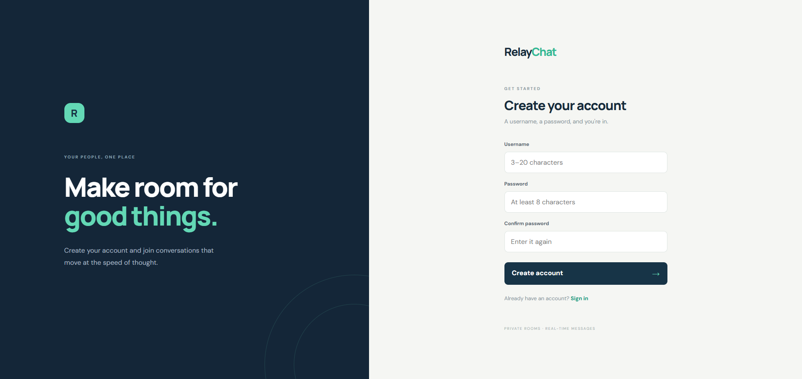
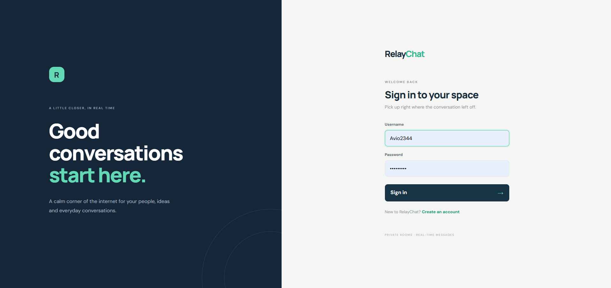
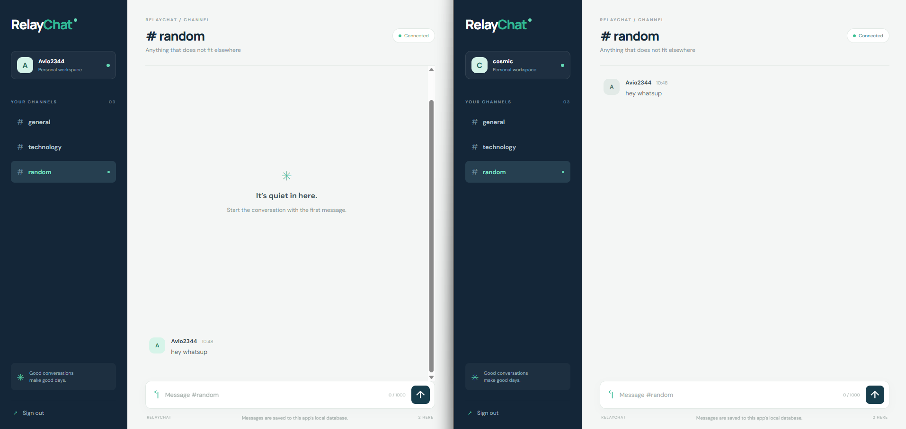
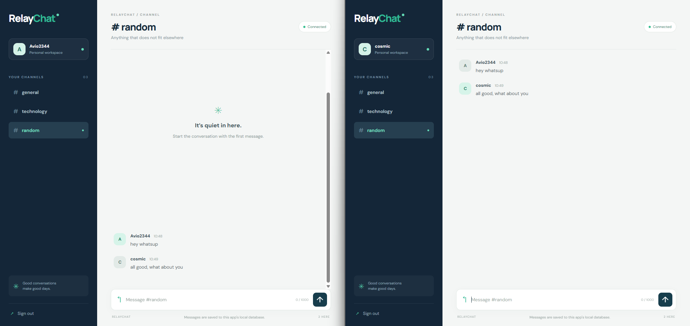
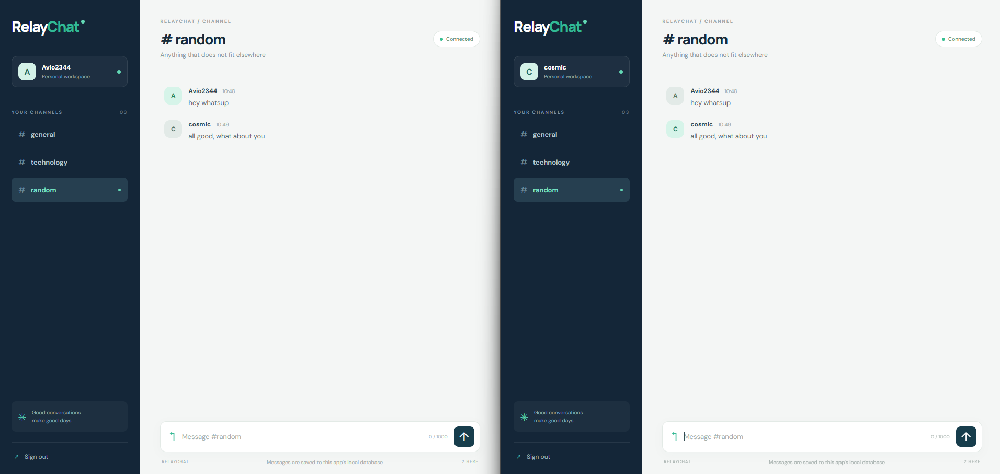
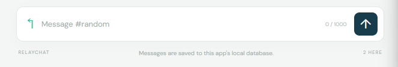

# RelayChat — Advanced Python Chat Application

RelayChat is a browser-based multi-room chat app built with Python, Flask, Flask-Sock, native browser WebSockets and SQLite.

## Features
- Registration and login with Werkzeug password hashing
- Session-protected chat page and WebSocket endpoint
- Three default rooms: `general`, `technology`, `random`
- Real-time messaging without page refresh
- SQLite message persistence and room history
- Online user count per room
- Empty-message and 1,000-character validation
- Responsive desktop/mobile interface
- No Node.js or external Socket.IO CDN dependency

## Requirements
- Python 3.9+
- Internet access to install Python packages; the client-side chat code is served locally.

## Windows / VS Code setup
Open this folder in VS Code. In Terminal → New Terminal run:

```powershell
py -m venv .venv
.\.venv\Scripts\Activate.ps1
py -m pip install -r requirements.txt
py app.py
```

Open `http://127.0.0.1:5000`.

If PowerShell blocks activation, use:
```powershell
.\.venv\Scripts\python.exe -m pip install -r requirements.txt
.\.venv\Scripts\python.exe app.py
```

## Test real-time messaging
1. Register one account in a normal browser window.
2. Open a second browser or Incognito window and register a different account.
3. Join the same room in both sessions.
4. Send messages in both directions; they should appear without refreshing.
5. Switch rooms and check that each room has its own history.
6. Refresh and verify old messages load from SQLite.
7. Close one session and check that the online count decreases.

## Structure
```text
RelayChat_Advanced/
├── app.py
├── database.py
├── requirements.txt
├── README.md
├── .gitignore
├── database/                 # DB is generated on first run
├── templates/
│   ├── base.html
│   ├── login.html
│   ├── register.html
│   └── chat.html
└── static/
    ├── css/style.css
    └── js/chat.js
```

## Message storage and security
- Passwords are stored as hashes, not plaintext.
- Messages are stored in `database/relaychat.db`.
- Messages are **not end-to-end encrypted** and are stored in readable form. Do not use this demo for sensitive conversations.
- The default Flask secret key is for local development only. Before deployment, set a long random `SECRET_KEY` environment variable and use HTTPS/WSS.
- Flask's built-in development server is not intended for production. Public deployment requires a production server and additional security review (including CSRF protection, rate limiting, origin restrictions and monitoring).
- The SQLite database is excluded from Git so local user data is not committed.

## Screenshots

### 1. Registration Page


### 2. Login Page


### 3. Chat Dashboard


### 4. Real-Time Messaging


### 5. Persistent Message History


### 6. Online Users

